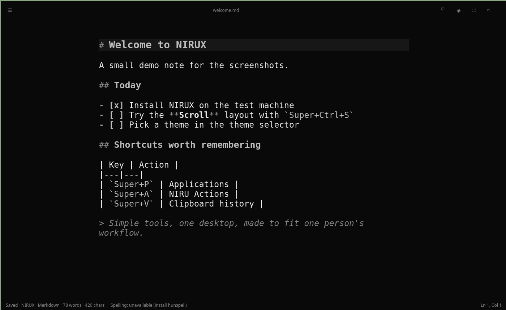

# NIRUNOTE

Minimal, keyboard-oriented Markdown editor with a styled preview.

**Status: beta** · Part of the [NIRUX](https://github.com/nirucon/nirux) suite · [MIT License](LICENSE)

**Version:** 0.7.0



## About

NIRUNOTE is the small, quiet editor I write notes and documentation in. It
edits plain Markdown files, shows a styled preview, and stays out of the way:
no accounts, no cloud, no database. It is written in Python with PySide6
(Qt 6).

It is a NIRU app first and a NIRUX extra second. With NIRUX installed it
follows the active NIRUX theme; elsewhere (for example on Arch/Omarchy with
Wayland) it is a normal Qt application.

## Features

- Markdown editing and a styled Preview (`Ctrl+Shift+E`) that follows the
  theme: CommonMark and GitHub Markdown (tables with alignment, task lists,
  strikethrough, autolinks, footnotes, nested quotes and lists), GitHub alerts
  (`> [!NOTE]`, `[!TIP]`, `[!IMPORTANT]`, `[!WARNING]`, `[!CAUTION]`), light
  syntax highlighting of fenced code (Python, shell, fish, TOML, YAML, JSON,
  INI, Rust, C/C++, Go, JavaScript/TypeScript, Java family, Lua, SQL, CSS,
  HTML/XML, Makefile, diff), and local and remote images scaled to the page.
- Safe Preview: raw HTML is not passed through (only a small formatting subset
  such as `kbd`, `sub`, `sup`, `mark`, `small` and `br`); links work for http,
  https, mailto, `#headings` and relative Markdown files, which open in the
  same window (`Alt+Left` goes back). Remote images are fetched only while the
  Preview shows them, at most 8 MB each, and can be turned off in Preferences.
- A read-only viewer (`--read-only`) and opening at a heading (`--heading`),
  used by `nirux manual`.
- Dark, light and Satie themes, plus **Follow NIRUX** when NIRUX is detected;
  focus mode and configurable writing width (Narrow, Normal, Wide, Full width).
- Find/replace (find also works in the Preview, `F3` / `Shift+F3` for
  next / previous), heading outline with type-to-filter (`Ctrl+Shift+O`) that
  jumps inside the Preview too, go to heading, recent files, Quick Open and a
  command palette.
- Monospace highlighting of fenced code blocks.
- Local spell checking with Hunspell when it and a dictionary are installed;
  the status line says exactly what is missing ("Spelling: unavailable
  (install hunspell-sv)").
- Crash recovery: snapshots are written only after real edits (about 2 s after
  typing stops, at most every 10 s), and after a crash you get Restore /
  Discard / Compare. Nothing is written while idle.
- Atomic saves. A file changed on disk is reloaded at once when there are no
  unsaved edits (always in the viewer), otherwise NIRUNOTE asks.
- A separate scratchpad instance (`--scratchpad`) with its own note file.
- Keyboard-complete dialogs with accessibility names.

## Requirements

- Linux with Python 3 and PySide6 (Qt Widgets). CI runs on Python 3.12, 3.13
  and 3.14.
- The installer can install Python 3 and PySide6 with `pacman` (Arch),
  `xbps-install` (Void, since 0.6.1) or `apt-get` (Debian). Without a
  terminal it cannot answer the package manager; use `./install.sh --yes`.
- Optional: `hunspell` for spell checking, and `curl` or `wget` so the
  installer can fetch the Swedish dictionary.

## Installation

### With NIRUX

NIRUNOTE is an optional extra, not part of a normal `nirux install`:

```sh
nirux extras install nirunote
nirux extras update            # later: update selected extras to the pinned version
```

NIRUX downloads the pinned release tag, verifies its SHA-256 and runs the
project's own `install.sh`.

### Standalone

```sh
./install.sh
nirunote
```

The installer:

1. installs PySide6 with your package manager if it is missing (may use
   `sudo`);
2. downloads a user-local Swedish Hunspell dictionary (from
   [yeager/hunspell-sv](https://github.com/yeager/hunspell-sv), with its
   license) to `~/.local/share/nirunote/dictionaries/` if one is not already
   working; no `sudo` is used for this;
3. stages the release, runs `--core-self-test`, the spell self-test and an
   offscreen GUI smoke test, and only then activates it under
   `~/.local/share/nirunote/current`;
4. writes the `~/.local/bin/nirunote` launcher, desktop entry and icon, and
   rolls back if the installed launcher fails `--version`.

Review `install.sh` before running it. To run from source without installing
(PySide6 required): `./run.sh` or `python3 nirunote/app.py`.

## Usage

```sh
nirunote                 # reopen the last document (if enabled in Preferences)
nirunote FILE.md         # open a file
nirunote --open FILE.md  # the same, explicit
nirunote --new           # start with an empty document
nirunote --focus         # start in focus mode
nirunote --scratchpad    # open the scratchpad note
nirunote --preview FILE.md                  # start in the Preview
nirunote FILE.md --read-only                # viewer: Preview, no editing or saving
nirunote FILE.md --heading "Key bindings"   # open at a heading (title or anchor)
nirunote --version
nirunote --help
```

| Key | Action |
|---|---|
| `Ctrl+N` / `Ctrl+Shift+N` | New / new from clipboard |
| `Ctrl+O` / `Ctrl+P` | Open / Quick Open |
| `Ctrl+S` / `Ctrl+Shift+S` | Save / Save As |
| `Ctrl+Q` | Quit |
| `Ctrl+Z` / `Ctrl+Shift+Z` | Undo / redo |
| `Ctrl+Shift+C` | Copy all |
| `Ctrl+Shift+V` | Paste as plain text |
| `Ctrl+Shift+D` | Duplicate line |
| `Ctrl+F` / `Ctrl+H` | Find / replace (find only in the Preview) |
| `F3` / `Shift+F3` | Find next / previous |
| `Esc` | Close the find bar |
| `Ctrl+B` / `Ctrl+I` / `Ctrl+K` | Bold / italic / link |
| `Ctrl+Shift+X` | Toggle checkbox |
| `Ctrl+Shift+8` / `Ctrl+Shift+7` / `Ctrl+Shift+.` | Bullet list / numbered list / quote |
| `Ctrl+G` / `Ctrl+Shift+O` | Go to heading / outline |
| `Alt+Left` | Back after following a link in the Preview |
| `Ctrl+Shift+P` | Command palette |
| `Ctrl+Shift+E` | Toggle Edit / Preview |
| `F11` | Focus mode |
| `Ctrl+Shift+F` | Toggle floating window |
| `Ctrl++` / `Ctrl+-` / `Ctrl+0` | Text size up / down / reset (also `Ctrl`+wheel, in the Preview too) |

## Configuration

All settings are in the app: **View** (theme, writing width, word wrap,
current-line highlight, text size) and **View → Preferences…**. The default
theme is Follow NIRUX when NIRUX is detected, dark otherwise. The default save
folder is `~/Documents`.

## Files and paths

| Path | Purpose |
|---|---|
| `~/.local/bin/nirunote` | Launcher |
| `~/.local/share/nirunote/releases/VERSION/` | Installed releases (`current` points to the active one) |
| `~/.local/share/nirunote/dictionaries/` | User-local Hunspell dictionary |
| `~/.config/NIRU/NIRUNOTE.conf` | Preferences (Qt `QSettings`, organization `NIRU`) |
| `~/.local/state/nirunote/recovery.json` | Crash recovery snapshot (`scratchpad-recovery.json` for the scratchpad) |
| `~/.local/state/nirunote/scratchpad.md` | The scratchpad note |
| `~/.local/state/nirunote/launcher.log` | Launcher log |

Documents stay local and are never uploaded. Hunspell runs as a local
subprocess. The only network access is the installer's dictionary download.

## Troubleshooting

- **"Spelling: unavailable".** Install `hunspell` and a dictionary
  (`hunspell-sv`, `hunspell-en-us` or your distribution's equivalent); system
  dictionaries are found as well as the user-local one. The status text is
  clickable.
- **The window does not start.** Check `~/.local/state/nirunote/launcher.log`
  and run `nirunote --version`.
- **A recovery prompt after a crash.** Choose Compare first if you are unsure
  which version to keep.

## Uninstall

```sh
nirux extras uninstall nirunote   # with NIRUX
./uninstall.sh                    # standalone, from a checkout
```

This removes the launcher, desktop entry, icon and `~/.local/share/nirunote`
(releases and dictionary). Settings and recovery state are kept; remove
`~/.config/NIRU/NIRUNOTE.conf` and `~/.local/state/nirunote` by hand only if
you also want to erase them. Your documents are never touched; back them up
independently.

## Building from source

There is nothing to compile. The checks CI runs:

```sh
python3 -m compileall -q nirunote gui-smoke-test.py tests
QT_QPA_PLATFORM=offscreen python3 nirunote/app.py --core-self-test
QT_QPA_PLATFORM=offscreen python3 gui-smoke-test.py
QT_QPA_PLATFORM=offscreen python3 tests/regression-test.py
python3 scripts/release-check.py   # version strings and trailing whitespace
```

Formatting uses `ruff format` (settings in `pyproject.toml`); ruff is not a
runtime dependency. The offscreen smoke test does not replace real desktop
testing; test Preview scrolling through long documents before a release.
Release history: [CHANGELOG.md](CHANGELOG.md) and
[RELEASE-NOTES.md](RELEASE-NOTES.md).

## Status, disclaimer and how it's made

**Status: beta.** Editing, preview, recovery and spelling work and are covered by regression tests on three Python versions. The offscreen tests do not replace real desktop testing, and the preview is deliberately simple.

NIRUX and every niru* project are made by me, Nicklas Rudolfsson
([@nirucon](https://github.com/nirucon)), for me. They are tailored to my own
needs, preferences and workflows, on my own machines. If they fit yours too,
that's a nice bonus.

- **Free and open source.** Anyone is free to use, study, change and share
  it under the [MIT License](LICENSE).
- **No guarantees.** There is no warranty of any kind. Use it at your own
  risk, read what you install and keep backups of anything that matters.
- **How it's made.** Some of these projects I built from scratch by hand. In
  more recent releases I have used Claude, Anthropic's AI, to do much of the
  heavy lifting under my direction: I decide what to build and how it should
  behave, and I test it on my own machines. It saves me a lot of time, and
  the result is quite OK.
- **Alpha, beta, dev, and maybe forever.** Most things here are alpha, beta
  or dev, and may stay that way. Maybe one day there will be a real stable
  release, but given how fast development moves, and how I am as a person,
  maybe never :)

| Label | Meaning |
|---|---|
| dev | Under active construction; may not build, install or work yet. |
| alpha | Works on my machines, but incomplete or rough; expect breaking changes. |
| beta | In daily use on my machines and mostly complete; rough edges remain. |

## License

MIT License, see [LICENSE](LICENSE). Copyright (c) 2026 Ing Leif Nicklas Rudolfsson.
