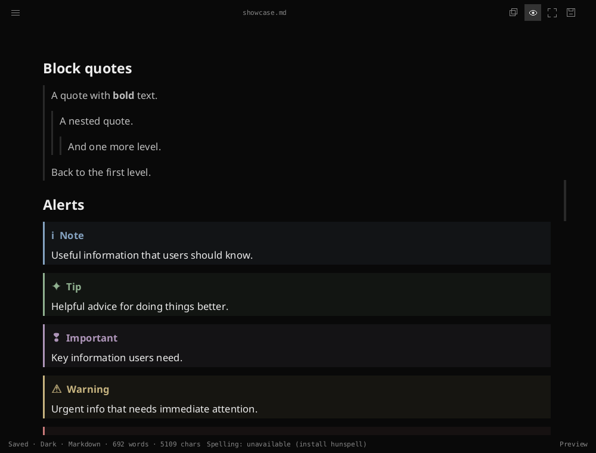

# NIRUNOTE

Minimal, keyboard-oriented Markdown editor with a styled preview.

**Status: beta** · Part of the [NIRUX](https://github.com/nirucon/nirux) suite · [MIT License](LICENSE)

**Version:** 1.0.0



## About

NIRUNOTE is the small, quiet editor I write notes and documentation in. It
edits plain Markdown files, shows a styled preview, and stays out of the way:
no accounts, no cloud, no database.

Since 1.0 it is one small static Rust program that draws its own window on
X11 (x11rb and a software canvas, like NIRUFM and NIRUTERM): no Qt, no
Python, no GTK. It opens in about 20 ms and uses about 12 MB of memory. With
NIRUX installed it follows the active NIRUX theme; elsewhere it is a normal
X11 application.

## Speed and memory

Measured on othala in the same private Xvfb with the same document
(`tests/fixtures/showcase.md`), four runs each:

| | 0.7.1 (Python, PySide6) | 1.0.0 (Rust) |
|---|---|---|
| Window shown / first frame | 275 to 327 ms (window visible) | 20 to 28 ms (first frame drawn) |
| Memory (RSS) | 86 MB | 14 MB (glibc build), 11 MB (static release) |
| Idle CPU | 0 to 2 ticks per 10 s | 0 ticks per 10 s (no timers while idle) |
| Open a 1.7 MB document | 0.85 s (1.9 MB, from the 0.7 notes) | 0.12 s, 22 MB |
| Its Preview | | ready after 0.7 s, 47 MB |

The caret does not blink, so an idle window wakes up only for events.

## Features

- Markdown editing with light, muted syntax highlighting (bold headings in a
  larger size, emphasis, code, lists, task boxes, quotes, links, fenced code
  on the panel colour) and a styled Preview (`Ctrl+Shift+E`) that follows
  the theme: CommonMark and GitHub Markdown (tables with alignment, task
  lists, strikethrough, autolinks, footnotes, nested quotes and lists),
  GitHub alerts (`> [!NOTE]`, `[!TIP]`, `[!IMPORTANT]`, `[!WARNING]`,
  `[!CAUTION]`), light syntax highlighting of fenced code (Python, shell,
  fish, TOML, YAML, JSON, INI, Rust, C/C++, Go, JavaScript/TypeScript, Java
  family, Lua, SQL, CSS, HTML/XML, Makefile, diff), and local and remote
  images scaled to the page (PNG, JPEG, GIF, WebP, SVG).
- Safe Preview: raw HTML is not passed through (only a small formatting
  subset such as `kbd`, `sub`, `sup`, `mark`, `small` and `br`); links work
  for http, https, mailto, `#headings` and relative Markdown files, which
  open in the same window (`Alt+Left` goes back). Remote images are fetched
  (with `curl` or `wget`) only while the Preview shows them, at most 8 MB
  each, and can be turned off in Preferences. Text in the Preview can be
  selected, copied and searched; `Tab` moves between links and `Enter`
  follows one.
- A read-only viewer (`--read-only`) and opening at a heading (`--heading`),
  used by `nirux manual`.
- Dark, light and Satie themes, plus **Follow NIRUX** when NIRUX is
  detected (live when the NIRUX theme changes); focus mode and configurable
  writing width (Narrow, Normal, Wide, Full width).
- Find/replace (find also works in the Preview, `F3` / `Shift+F3` for
  next / previous, `Tab` reaches every control of the find bar), heading
  outline with type-to-filter (`Ctrl+Shift+O`) that jumps inside the
  Preview too, go to heading, recent files, Quick Open and a command palette.
- Writing helpers: list and quote continuation on `Enter` (an empty item
  ends the list), `Tab` / `Shift+Tab` indent list items, bold, italic,
  links, checkboxes, bullets, numbers and quotes from the keyboard.
- Local spell checking with Hunspell when it and a dictionary are installed,
  with suggestions, "Add to dictionary" and "Ignore" in the context menu;
  the status line says exactly what is missing ("Spelling: unavailable
  (install hunspell-sv)") and opens the spelling settings when clicked.
- Crash recovery: snapshots are written only after real edits (about 2 s
  after typing stops, at most every 10 s), and after a crash you get Restore
  / Discard / Compare. Nothing is written while idle.
- Atomic saves that keep the file's line endings (LF or CRLF) and BOM; the
  last five versions before each save are kept in
  `~/.local/state/nirunote/snapshots`. A file changed on disk is reloaded at
  once when there are no unsaved edits (always in the viewer), otherwise
  NIRUNOTE asks.
- A separate scratchpad instance (`--scratchpad`) with its own note file.
- Everything works from the keyboard, including the menu (`F10`), the
  context menu (`Shift+F10`), the file chooser and every dialog. Files can
  be dropped on the window.

## Requirements

- Linux with an X11 session (NIRUWM or any other window manager), x86_64
  for the prebuilt binary. The binary is static: no runtime libraries.
- `fc-match` (fontconfig) to find the `monospace` and `sans-serif` fonts;
  DejaVu is used when it is missing.
- Optional: `hunspell` and a dictionary for spell checking, `curl` or
  `wget` for remote images in the Preview and for the installer,
  `xdg-open` for web links and "Open containing folder".

## Installation

### With NIRUX

NIRUNOTE is an optional extra, not part of a normal `nirux install`:

```sh
nirux extras install nirunote
nirux extras update            # later: update selected extras to the pinned version
```

NIRUX downloads the pinned release tag, verifies its SHA-256 and runs the
project's own `install.sh`.

### Standalone

```sh
./install.sh
nirunote
```

The installer:

1. downloads the prebuilt static binary of this version from the GitHub
   release and verifies it against the release's `SHA256SUMS` (or uses
   `./nirunote` beside the script, or `target/release/nirunote`; with
   `--build` it builds with cargo first);
2. checks it (`--version`, `--core-self-test`) before anything changes, then
   replaces `~/.local/bin/nirunote` in one rename and rolls back if the
   installed binary does not start;
3. writes the desktop entry and icon;
4. removes a NIRUNOTE 0.x (Python) installation's releases under
   `~/.local/share/nirunote` (settings, the scratchpad, recovery data and
   dictionaries stay);
5. when Hunspell is installed, downloads a user-local Swedish dictionary
   (from [yeager/hunspell-sv](https://github.com/yeager/hunspell-sv), with its
   license) to `~/.local/share/nirunote/dictionaries/` if none works yet. No
   `sudo` is used anywhere.

Review `install.sh` before running it.

### Upgrading from 0.x

Run the installer as above. Settings in `~/.config/NIRU/NIRUNOTE.conf`
(including recent files, remembered cursor positions and the window size),
the scratchpad note, recovery snapshots and the personal word list are read
as they are. A NIRUNOTE window that is already open keeps running the old
version until it is closed.

## Usage

```sh
nirunote                 # reopen the last document (if enabled in Preferences)
nirunote FILE.md         # open a file
nirunote --open FILE.md  # the same, explicit
nirunote --new           # start with an empty document
nirunote --focus         # start in focus mode
nirunote --scratchpad    # open the scratchpad note
nirunote --preview FILE.md                  # start in the Preview
nirunote FILE.md --read-only                # viewer: Preview, no editing or saving
nirunote FILE.md --heading "Key bindings"   # open at a heading (title or anchor)
nirunote --version
nirunote --help
```

The window class is `nirunote` (WM_CLASS `nirunote`, `NIRUNOTE`), so window
rules and NIRUWM's scratchpad slot (`sh -c "exec nirunote" --class nirunote`)
match it.

| Key | Action |
|---|---|
| `Ctrl+N` / `Ctrl+Shift+N` | New / new from clipboard |
| `Ctrl+O` / `Ctrl+P` | Open / Quick Open |
| `Ctrl+S` / `Ctrl+Shift+S` | Save / Save As |
| `Ctrl+Q` | Quit |
| `Ctrl+Z` / `Ctrl+Shift+Z` (or `Ctrl+Y`) | Undo / redo |
| `Ctrl+X` / `Ctrl+C` / `Ctrl+V` | Cut / copy / paste (also `Shift+Delete`, `Ctrl+Insert`, `Shift+Insert`, middle click) |
| `Ctrl+A` | Select all |
| `Ctrl+Shift+C` | Copy all |
| `Ctrl+Shift+V` | Paste as plain text |
| `Ctrl+Shift+D` | Duplicate line |
| `Ctrl+F` / `Ctrl+H` | Find / replace (find only in the Preview) |
| `F3` / `Shift+F3` | Find next / previous |
| `Esc` | Close the find bar, leave focus mode |
| `Ctrl+B` / `Ctrl+I` / `Ctrl+K` | Bold / italic / link |
| `Ctrl+Shift+X` | Toggle checkbox |
| `Ctrl+Shift+8` / `Ctrl+Shift+7` / `Ctrl+Shift+.` | Bullet list / numbered list / quote |
| `Tab` / `Shift+Tab` | Indent / outdent a list item |
| `Ctrl+G` / `Ctrl+Shift+O` | Go to heading / outline |
| `Alt+Left` | Back after following a link in the Preview |
| `Ctrl+Shift+P` | Command palette |
| `Ctrl+Shift+E` | Toggle Edit / Preview |
| `F11` | Focus mode |
| `Ctrl+Shift+F` | Toggle floating window |
| `Ctrl++` / `Ctrl+-` / `Ctrl+0` | Text size up / down / reset (also `Ctrl`+wheel, in the Preview too) |
| `F10` / `Shift+F10` | Menu / context menu |

In the Open and Save As chooser: type to filter or type a path, `Enter`
opens a folder or chooses, `Backspace` in an empty field goes up a folder,
`Tab` completes, `Ctrl+H` shows hidden files and `Ctrl+T` shows all files.

## Configuration

All settings are in the app: **View** (theme, writing width, word wrap,
current-line highlight, text size) and **View → Preferences…**. The default
theme is Follow NIRUX when NIRUX is detected, dark otherwise. The default
save folder is `~/Documents`. The editor uses the `monospace` font and the
Preview `sans-serif`, as fontconfig resolves them; the size is in points
(17 by default) and follows `Xft.dpi`.

## Files and paths

| Path | Purpose |
|---|---|
| `~/.local/bin/nirunote` | The program |
| `~/.config/NIRU/NIRUNOTE.conf` | Preferences, recent files, cursor positions, window geometry (the Qt `QSettings` file of 0.x, unchanged) |
| `~/.local/state/nirunote/recovery.json` | Crash recovery snapshot (`scratchpad-recovery.json` for the scratchpad) |
| `~/.local/state/nirunote/recovery-discarded.json` | One copy of discarded text |
| `~/.local/state/nirunote/scratchpad.md` | The scratchpad note |
| `~/.local/state/nirunote/snapshots/` | The last five versions before a save |
| `~/.local/state/nirunote/launcher.log` | Why a window could not start |
| `~/.local/share/nirunote/dictionaries/` | User-local Hunspell dictionary and `personal.txt` |
| `~/.cache/nirunote/fonts` | Font paths found by fontconfig |

Documents stay local and are never uploaded. Hunspell runs as a local
subprocess. The only network access is the installer's downloads and remote
images in the Preview (which can be turned off).

## Troubleshooting

- **"Spelling: unavailable".** Install `hunspell` and a dictionary
  (`hunspell-sv`, `hunspell-en-us` or your distribution's equivalent);
  system dictionaries are found as well as the user-local one. The status
  text is clickable.
- **The window does not start.** Run `nirunote --version`, then `nirunote`
  in a terminal, and check `~/.local/state/nirunote/launcher.log`.
- **A recovery prompt after a crash.** Choose Compare first if you are unsure
  which version to keep.

## Uninstall

```sh
nirux extras uninstall nirunote   # with NIRUX
./uninstall.sh                    # standalone, from a checkout
./uninstall.sh --purge            # also settings, scratchpad, recovery data, dictionaries
```

Without `--purge` the settings, the scratchpad note, recovery data and the
dictionaries are kept. Your documents are never touched; back them up
independently.

## Building from source

```sh
cargo build --release
./install.sh --build              # build and install
```

The checks CI runs (Xvfb, xdotool, xclip and xprop are needed for the last):

```sh
cargo fmt --check
cargo clippy --all-targets -- -D warnings
cargo test
sh tests/xvfb.sh target/release/nirunote
```

`tests/xvfb.sh` starts a private Xvfb and drives NIRUNOTE with xdotool:
first frame, memory and idle CPU, editing and saving, undo to the saved
state, recovery after `kill -9`, find and replace, the Markdown helpers,
the Preview with links and Back, Quick Open, Outline, the read-only viewer
with `--heading`, the scratchpad, the settings file, the clipboard, the
unsaved-changes prompt and spelling. The Markdown renderer is tested
against the HTML of the 0.7 Python renderer (`tests/fixtures/showcase.*`).

Release history: [CHANGELOG.md](CHANGELOG.md) and
[RELEASE-NOTES.md](RELEASE-NOTES.md).

## Status, disclaimer and how it's made

**Status: beta.** Editing, preview, recovery and spelling work and are covered by unit tests and an X11 end-to-end test. The preview is deliberately simple.

NIRUX and every niru* project are made by me, Nicklas Rudolfsson
([@nirucon](https://github.com/nirucon)), for me. They are tailored to my own
needs, preferences and workflows, on my own machines. If they fit yours too,
that's a nice bonus.

- **Free and open source.** Anyone is free to use, study, change and share
  it under the [MIT License](LICENSE).
- **No guarantees.** There is no warranty of any kind. Use it at your own
  risk, read what you install and keep backups of anything that matters.
- **How it's made.** Some of these projects I built from scratch by hand. In
  more recent releases I have used Claude, Anthropic's AI, to do much of the
  heavy lifting under my direction: I decide what to build and how it should
  behave, and I test it on my own machines. It saves me a lot of time, and
  the result is quite OK.
- **Alpha, beta, dev, and maybe forever.** Most things here are alpha, beta
  or dev, and may stay that way. Maybe one day there will be a real stable
  release, but given how fast development moves, and how I am as a person,
  maybe never :)

| Label | Meaning |
|---|---|
| dev | Under active construction; may not build, install or work yet. |
| alpha | Works on my machines, but incomplete or rough; expect breaking changes. |
| beta | In daily use on my machines and mostly complete; rough edges remain. |

## License

MIT License, see [LICENSE](LICENSE). Copyright (c) 2026 Ing Leif Nicklas Rudolfsson.
