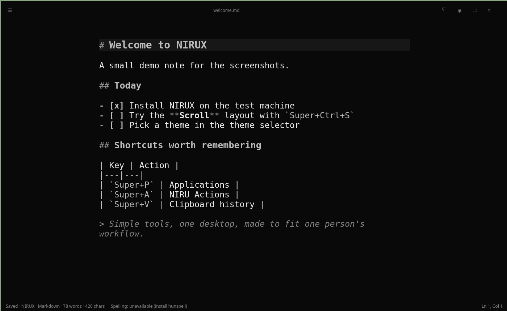

# NIRUNOTE Markdown showcase

This file exercises every Markdown feature the Preview renders. It doubles as
a regression fixture, so keep it **complete** rather than pretty.

## Emphasis and inline text

Plain, *italic*, _also italic_, **bold**, __also bold__, ***bold italic***,
~~strikethrough~~, `inline code`, and ``code with a ` backtick``.
Snake_case_words and 2 * 3 * 4 stay as they are. <kbd>Ctrl</kbd>+<kbd>S</kbd> saves,
H<sub>2</sub>O, E = mc<sup>2</sup>, <mark>marked</mark> and <small>small print</small>.

Escapes: \*not italic\*, \# not a heading, \[not a link\], 1\. not a list, \\ backslash.
Entities: &copy; &amp; &lt;tag&gt; &#169; &#x2603; &nbsp;and &unknown; stays.

Hard break with two spaces  
next line, and with a backslash\
third line. A soft
line break joins.

## Links and images

An [inline link](https://example.com "Example title"), a [reference link][ref],
a [collapsed reference][], a [shortcut] link, an autolink <https://nirux.org>,
a bare URL https://github.com/nirucon/nirunote, www.example.org and
mail@example.com. Jump to [the tables section](#tables) or open
[another chapter](other.md#some-heading). Unsafe: [javascript](javascript:alert(1)),
[file](file:///etc/passwd).

[ref]: https://example.com/ref
[collapsed reference]: https://example.com/collapsed
[shortcut]: <https://example.com/shortcut> 'Shortcut'

Local image (scaled down to the page width):



Local SVG (shown when QtSvg is installed, else its alt text): 

Remote image: 

Missing image: 

## Lists

- First bullet
- Second bullet with `code`
  - Nested bullet
    - Deeper bullet
- Third bullet

1. One
2. Two
   1. Two point one
   2. Two point two
3. Three

A paragraph ends the list, so the next one can start at seven:

7. Starts at seven
8. Eight

* Loose list item one

* Loose list item two with a second paragraph

  The second paragraph belongs to the item.

### Task list

- [x] Write the renderer
- [ ] Take screenshots
- [ ] Release

## Block quotes

> A quote with **bold** text.
>
> > A nested quote.
> > > And one more level.
>
> Back to the first level.

## Alerts

> [!NOTE]
> Useful information that users should know.

> [!TIP]
> Helpful advice for doing things better.

> [!IMPORTANT]
> Key information users need.

> [!WARNING]
> Urgent info that needs immediate attention.

> [!CAUTION]
> Advises about risks or negative outcomes.

## Code

```python
@decorator
def greet(name: str = "world") -> None:
    """Say hello."""
    # comment
    for i in range(3):
        print(f"Hello {name} {i}", 0x1F, 3.14)
```

```sh
# Install and run
nirux extras install nirunote && nirunote --read-only --heading "Tables" ~/notes.md
export EDITOR=nirunote; echo "$HOME/${XDG_CONFIG_HOME:-.config}" | grep -q config
```

```toml
[general]
theme = "Follow NIRUX" # comment
font_size = 17
enabled = true
```

```rust
fn main() {
    let v: Vec<u32> = (1..=3).collect();
    println!("{:?} {}", v, 'x');
}
```

```json
{"name": "nirunote", "version": "0.7.0", "light": true, "deps": null}
```

```diff
--- a/file
+++ b/file
@@ -1,2 +1,2 @@
-old line
+new line
 context
```

```
A fence without a language stays plain.
```

    Indented code block
    with two lines.

A long code line must wrap rather than break the layout:

```text
this-is-a-very-long-line-without-spaces-that-goes-on-and-on-and-on-and-on-and-on-and-on-and-on-and-on-and-on-and-on-and-on-and-on
```

## Tables

| Left | Center | Right |
|:-----|:------:|------:|
| a | b | 1 |
| `code` | **bold** | 22 |
| escaped \| pipe | [link](https://example.com) | 333 |

A wide table:

| Command | What it does | Default | Notes | More notes | Even more |
|---|---|---|---|---|---|
| `nirunote --read-only --heading "Some heading" file.md` | Opens the file read-only, scrolled to the heading | off | A long cell that has to wrap across several lines to fit | x | y |
| `averyveryveryverylongunbreakabletokenthatdoesnotwrapanywhereatall` | Long tokens | - | - | - | - |

## Rules and breaks

Above a rule.

---

***

Below the rules.

Setext heading one
==================

Setext heading two
------------------

## Footnotes

Here is a footnote reference[^1] and another one[^long].

[^1]: The first footnote.
[^long]: A longer footnote with `code` and a [link](https://example.com).

## Long lines

A very long word: Pneumonoultramicroscopicsilicovolcanoconiosis-and-then-some-more-text-without-spaces-that-keeps-going-and-going-until-it-must-wrap.

A long URL: https://example.com/a/very/long/path/that/keeps/going/and/going/and/going/and/going/and/going/forever?with=query&and=more

## Headings with the same name

### Details

### Details

#### Level four

##### Level five

###### Level six

## HTML that is not passed through

<script>alert("no")</script>

<details>
<summary>Summary text</summary>

Content inside details.
</details>

<!-- An HTML comment is hidden. -->

The end.
